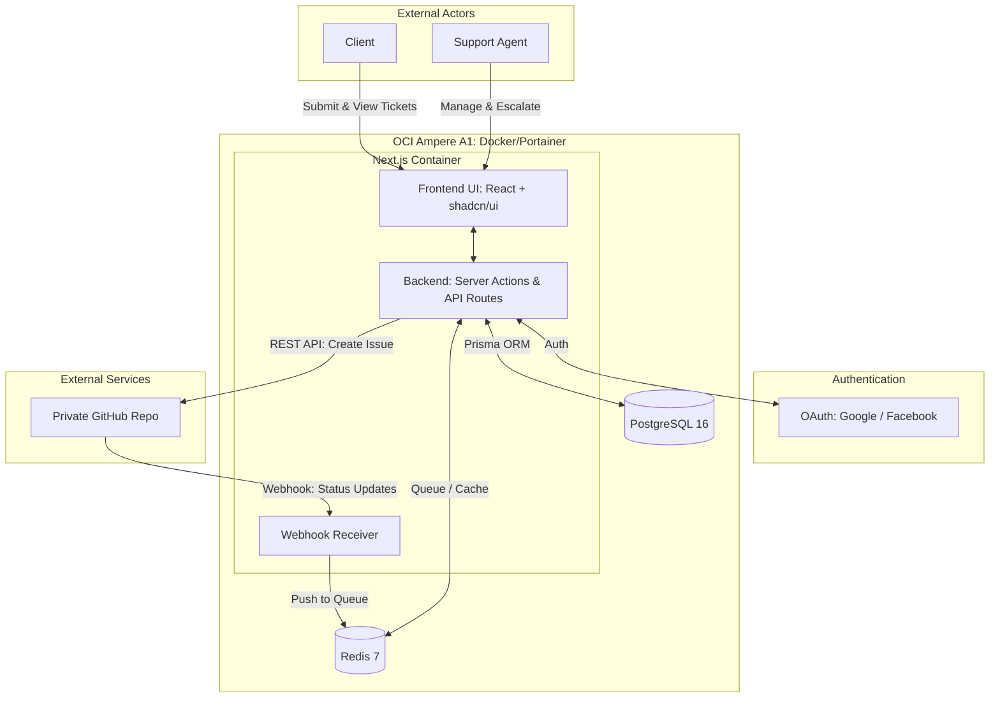
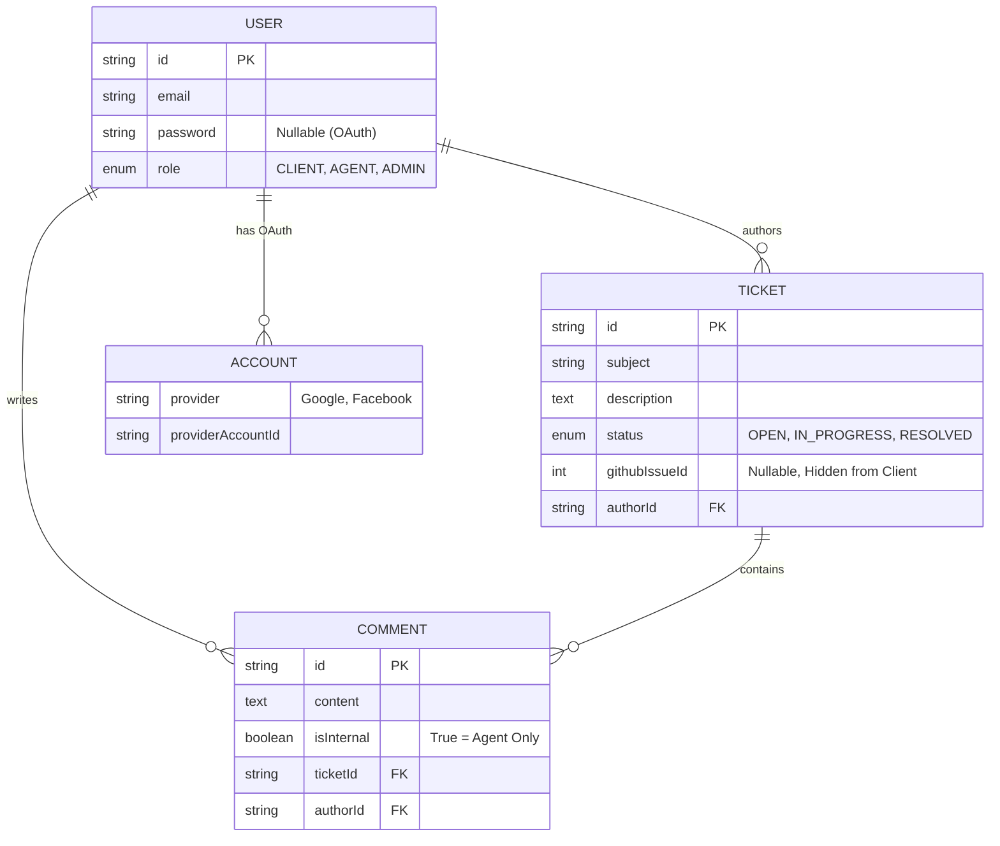
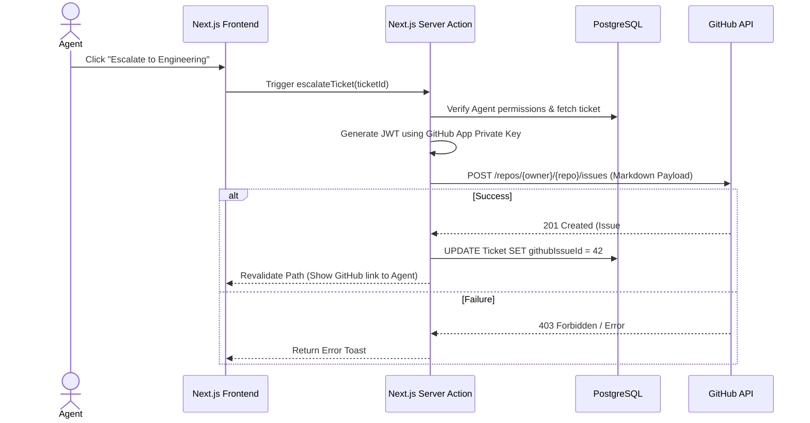
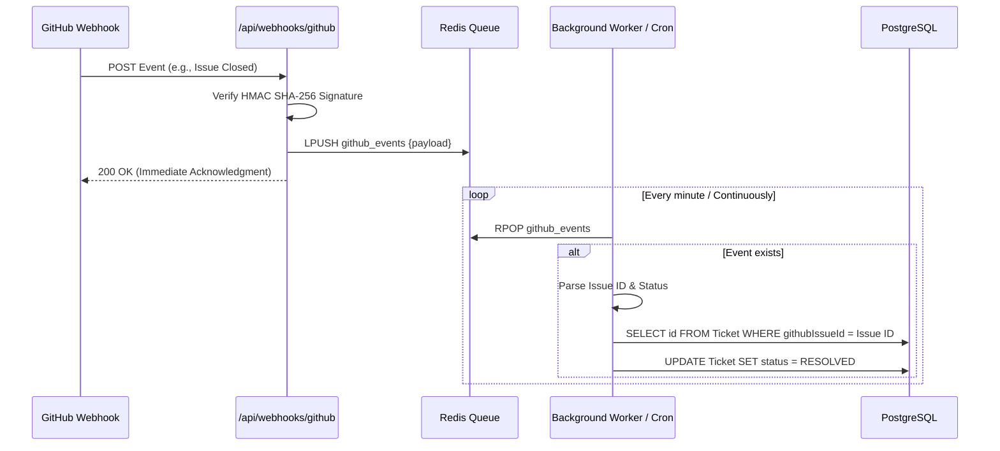

# Architecture Document: Issue-Bridge (GitHub-Proxy Ticketing System)

This document outlines the system architecture, infrastructure, data model, and core workflows for **Issue-Bridge**, a secure proxy ticketing platform designed to decouple client-facing support interactions from internal engineering workflows hosted in a private GitHub repository.

---

### 1. High-Level System Architecture

The system operates as a unified Next.js full-stack application. It acts as a secure boundary between external users (Clients), internal users (Support Agents), and the engineering source of truth (GitHub).

**Architecture Components:**

* **Next.js App Router (Frontend + Backend):** Handles SSR/SSG rendering, client-side interactions, and server-side business logic. Client and Agent UIs are isolated via route groups `(client)` and `(dashboard)`.
* **PostgreSQL:** The primary relational data store for users, tickets, internal comments, and authentication state.
* **Redis:** Serves as a high-throughput message queue to buffer incoming GitHub webhooks, preventing timeout disconnects during traffic spikes or database locks.
* **Authentication Boundary:** Managed by Auth.js using a JWT strategy, supporting OAuth (Google, Facebook) and standard Credentials.

---

### 2. Infrastructure & Deployment (OCI Always Free)

The deployment architecture leverages Oracle Cloud Infrastructure (OCI) Ampere A1 ARM-based compute instances, orchestrated via Docker and Portainer.

**Deployment Specifications:**

* **Compute:** VM.Standard.A1.Flex (4 OCPUs, 24GB RAM).
* **Architecture Constraint:** All Docker images must be built for the `linux/arm64` architecture. Next.js uses standalone output mode to minimize container footprint.
* **Orchestration:** A single `docker-compose.yml` deployed via Portainer manages the Next.js, Postgres, and Redis containers on an internal Docker bridge network, ensuring DB and Cache ports are never exposed to the public internet.

---

### 3. Data Model Architecture

The data architecture enforces strict separation of concerns. The GitHub Issue ID is stored, but is never queried or transmitted to the client-facing APIs.

**Key Data Design Decisions:**

* `isInternal`: Allows agents to have discussions on a ticket that clients cannot see.
* `githubIssueId`: A nullable integer. If populated, the ticket is linked to the engineering team.
* **Auth.js Linking:** The `ACCOUNT` table allows a single user email to log in via multiple OAuth providers or standard credentials seamlessly.

---

### 4. Core System Workflows

#### A. Ticket Escalation (Agent to GitHub)

When a support agent determines a ticket requires a code fix, they escalate it. The system uses a GitHub App (not a Personal Access Token) to authenticate.

#### B. Asynchronous Webhook Processing (GitHub to System)

To prevent dropping webhooks if the database is busy, the webhook endpoint acts only as a receiver, offloading the work to Redis.

**Security Implementations:**

1. **HMAC Verification:** The webhook receiver validates the `x-hub-signature-256` header against the GitHub App Webhook Secret to ensure payloads cannot be spoofed.
2. **Environment Variable Isolation:** The GitHub App Private Key and Client Secrets exist only inside the backend Node.js process and are never exposed to the `NEXT_PUBLIC_` environment space.
